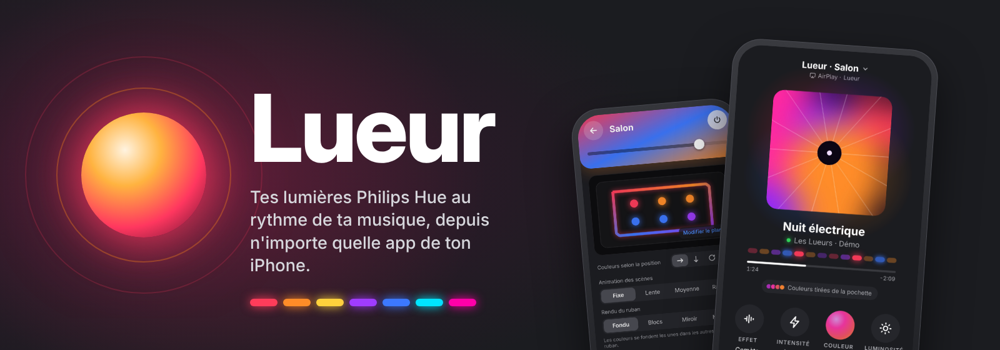
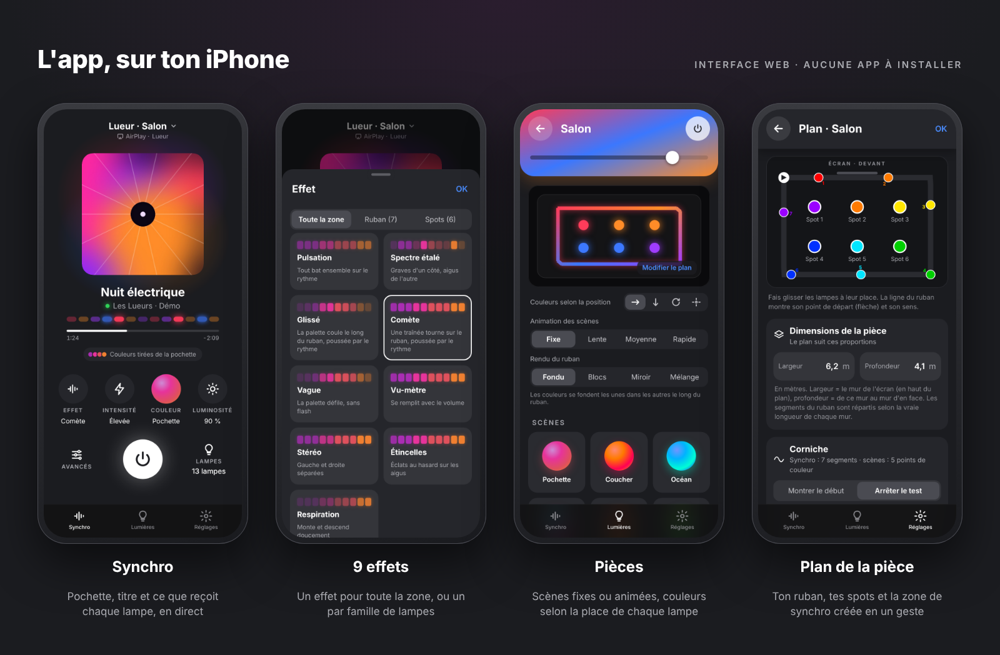
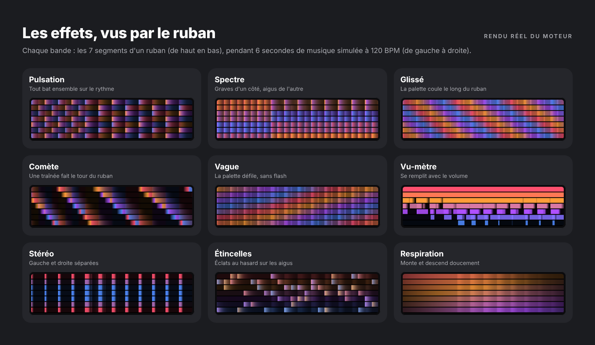
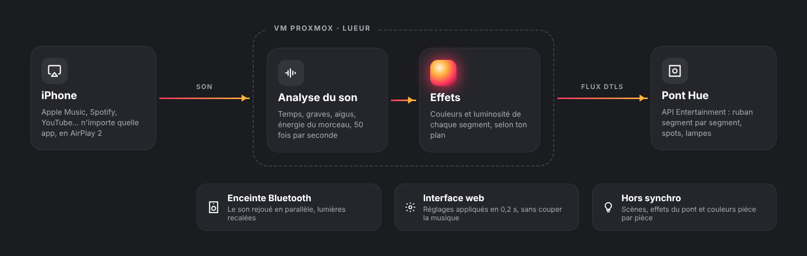

<p align="center">
  
</p>

<p align="center">
  <b>Récepteur AirPlay 2</b> · <b>Synchro Philips Hue</b> · <b>Enceinte Bluetooth</b> · <b>VM Proxmox clé en main</b>
</p>

---

**Lueur** transforme une petite VM Proxmox en enceinte AirPlay 2. Tu envoies ta musique dessus depuis l'iPhone (Apple Music, Spotify, YouTube, n'importe quelle app), elle écoute le son en temps réel et fait danser tes lampes Hue : le ruban segment par segment, les spots, les lampes. Le son peut aussi repartir sur une enceinte Bluetooth branchée au serveur.

Tout se règle depuis une interface web pensée pour le téléphone, au style de l'app Hue. Rien à installer sur l'iPhone.

<p align="center">
  
</p>

## Ce que fait Lueur

### 🎵 Synchro musique → lumières
- **N'importe quelle source** : tout ce que l'iPhone peut envoyer en AirPlay 2, en multi-room avec tes autres enceintes AirPlay.
- **Analyse en direct**, 50 fois par seconde : grosse caisse, caisse claire, graves, aigus et énergie du morceau.
- **9 effets** : Pulsation, Spectre, Glissé, Comète, Vague, Vu-mètre, Stéréo, Étincelles, Respiration.
- **Un effet par famille de lampes** si tu veux : par exemple Comète sur le ruban et Pulsation sur les spots.
- **Vitesse** demi-temps, normale ou double, **4 intensités** (Subtile → Intense) et des réglages avancés : sensibilité, force et durée des flashs, fondu des couleurs, flash blanc sur les drops.
- **Palette « Pochette »** : les couleurs sont tirées automatiquement de la pochette du morceau en cours.
- **Équilibre de luminosité** par lampe, réglable pendant que la musique joue.
- **Pause automatique** : après un silence, les lampes reviennent à l'app Hue.

### 💡 Tes pièces, hors synchro
- Allumer, éteindre et régler chaque pièce ou lampe, avec une roue de couleurs.
- **Scènes** qui colorent chaque lampe selon sa place dans la pièce, fixes ou **animées** par le pont.
- **Rendu du ruban** : fondu, blocs, miroir ou mélange.
- **Effets intégrés du pont** : Bougie, Âtre, Pétillement, Prisme, Opale, Sous l'eau, Cosmos…
- **Palettes perso**, créées à partir d'une photo ou couleur par couleur.

### 📐 Plans et zones de synchro
- **Plan de chaque pièce**, avec ses vraies dimensions : tu poses tes spots au doigt et tu traces le ruban le long des murs (coin de départ, sens, nombre de murs).
- **Zone de synchro créée en un geste** depuis le plan. Plus besoin de passer par l'app Hue : Lueur crée la zone sur le pont avec **un canal par segment du ruban**.
- **Outils de réglage** : « Montrer le début » allume le ruban du rouge (début) au bleu (fin). « Couleurs par segment » donne à chaque segment sa couleur, et chaque spot prend celle du segment le plus proche sur le plan, pour vérifier d'un coup d'œil que tout est bien placé.

### 🔊 Son
- **Enceinte Bluetooth** : recherche, appairage, reconnexion automatique, et un décalage réglable pour caler les lumières sur le son.
- **Nom AirPlay** modifiable depuis l'interface.

<p align="center">
  
</p>

## Prérequis

| | |
|---|---|
| **Serveur** | Proxmox VE 8, avec accès Internet |
| **Ressources** | 2 cœurs, 1 Go de RAM, 8 Go de disque |
| **Éclairage** | Pont Hue v2 (carré) et lampes **couleur** (ruban dégradé conseillé) |
| **Source** | iPhone, iPad ou Mac (AirPlay 2) |
| **Bluetooth** *(facultatif)* | Adaptateur Bluetooth USB sur l'hôte |

> [!IMPORTANT]
> L'iPhone, le pont Hue et la VM doivent être sur le **même réseau** (même VLAN), sinon l'enceinte AirPlay n'apparaît pas.

## Installation

Dans le shell de l'hôte Proxmox, en root :

```bash
bash -c "$(curl -fsSL https://raw.githubusercontent.com/J4y2s/Lueur/V.1.2/create-hue-sync-vm.sh)"
```

> [!TIP]
> Utilise bien cette forme, et pas `curl … | bash` : le script doit pouvoir te poser une question si l'hôte a plusieurs adaptateurs Bluetooth.

Le script :

1. télécharge l'image officielle **Debian 12** (version cloud, sans interface graphique) et vérifie sa somme de contrôle ;
2. crée la VM et lui attribue l'adaptateur Bluetooth trouvé sur l'hôte ;
3. installe tout au premier démarrage : AirPlay 2, synchro, interface web, Bluetooth ;
4. redémarre la VM une fois pour activer le Bluetooth, puis affiche l'adresse de l'interface et le mot de passe de la VM.

Compte **15 à 25 minutes**, surtout pour la compilation d'AirPlay 2.

<details>
<summary><b>Options de création</b></summary>

À placer devant la commande, par exemple `VLAN=20 VMID=150 bash -c "$(curl …)"`.

| Variable | Par défaut | Rôle |
|---|---|---|
| `VMID` | prochain libre | Numéro de la VM |
| `NAME` | `hue-sync` | Nom de la VM |
| `STORAGE` | `local-lvm` ou `local-zfs` | Stockage du disque |
| `BRIDGE` | `vmbr0` | Pont réseau |
| `VLAN` | *(aucun)* | Tag VLAN |
| `MEMORY` | `1024` | RAM en Mo |
| `CORES` | `2` | Cœurs |
| `DISK` | `8G` | Taille du disque |
| `BT_USB` | détection auto | Adaptateur Bluetooth (`vendor:product`), ou `none` |

</details>

### Mettre à jour

Sur l'hôte Proxmox (remplace `106` par le numéro de ta VM). Tes réglages, plans, palettes et l'appairage sont conservés :

```bash
qm guest exec 106 --timeout 600 -- bash -c 'curl -fsSL "https://raw.githubusercontent.com/J4y2s/Lueur/V.1.2/update-hue-sync.sh?$(date +%s)" | bash'
```

Le `?$(date +%s)` évite de récupérer une ancienne version gardée en cache par GitHub. Depuis la VM, `sudo bash update-hue-sync.sh` fait la même chose.

## Premiers pas

1. **Ouvre l'interface** : `http://<ip-de-la-vm>:8080`.
   Astuce : dans Safari, *Partager → Sur l'écran d'accueil*, pour l'avoir comme une vraie app.
2. **Appaire le pont** : il est trouvé tout seul. Appuie sur son gros bouton rond quand l'interface te le demande.
3. **Fais le plan de ta pièce** : *Réglages → Pièces et zones de synchro → ta pièce*.
   - Renseigne la **largeur** (le mur de l'écran) et la **profondeur**, en mètres.
   - Touche **« Montrer le début »**, place la flèche du plan là où le ruban s'allume en rouge, puis règle le **sens** et le **nombre de murs**.
   - Pose tes **spots** au doigt.
4. **Crée la zone de synchro** : bouton **« Créer la zone de synchro »**, en bas du plan. Lueur crée la zone sur le pont et la choisit pour la musique.
5. **Vérifie tout d'un coup d'œil** avec **« Couleurs par segment »** : chaque spot doit avoir la même couleur que le bout de ruban juste à côté de lui. Sinon, déplace-le sur le plan : les lampes suivent en direct.
6. Sur l'iPhone, lance ta musique puis **AirPlay → « Lueur »**. Choisis un effet, une palette, une intensité : tout s'applique sans couper le son.

### Deux façons d'écouter

- **Avec une enceinte Bluetooth** branchée au serveur : connecte-la dans *Réglages → Enceinte Bluetooth*, puis envoie la musique seulement à « Lueur ». Si les lumières sont en avance sur le son, augmente le *décalage des lumières*.
- **Avec des enceintes AirPlay** (HomePod, Sonos…) : dans le menu AirPlay, coche **tes enceintes et « Lueur »**. AirPlay 2 garde tout le monde synchronisé.

> [!NOTE]
> Une enceinte Bluetooth connectée directement à l'iPhone ne peut pas être combinée avec AirPlay : c'est une limite d'iOS.

## Comment ça marche

<p align="center">
  
</p>

- **shairport-sync** reçoit le son AirPlay 2, avec le titre et la pochette.
- **Le moteur** (`hue_music_sync.py`) analyse le son et calcule la couleur de chaque canal 50 fois par seconde, en suivant ton plan : ordre réel des segments, place des spots, proportions de la pièce.
- Les couleurs partent au pont par l'**API Entertainment de Hue**, en flux chiffré (DTLS).
- **L'interface web** (`hue_sync_web.py` + `index.html`, sans dépendance) écrit les réglages, que le moteur relit toutes les 0,2 s.

## Bon à savoir

- **Segments du ruban** : leur nombre est fixé par le pont selon le modèle (7 pour un ruban Flux, quelle que soit sa longueur), et il ne se change ni dans l'app Hue ni par l'API. Sur un long ruban, chaque segment fait donc plusieurs mètres.
- **Un canal par segment** : le pont ne garde les segments séparés que si le ruban est placé à un endroit précis de la zone de divertissement. Ailleurs, il les regroupe en 1 à 5 canaux. Les zones créées par Lueur le placent toujours au bon endroit. Si tu crées une zone dans l'app Hue, le ruban peut avoir moins de canaux.
- **Une zone à la fois** : un pont ne joue qu'un seul flux de divertissement, donc Lueur synchronise une zone à la fois. Elle peut contenir jusqu'à 10 lampes.
- **Scènes et synchro** : un dégradé de scène a 5 points de couleur au maximum (limite de l'API Hue), alors qu'en synchro le ruban est piloté segment par segment.
- **Analyse en direct** : contrairement à l'intégration Spotify de Hue, Lueur ne connaît pas le morceau à l'avance. Le résultat est très proche sur la musique rythmée, un peu moins « chorégraphié » sur les morceaux calmes.
- **Pièces rectangulaires** : le plan représente la pièce comme un rectangle.

> [!WARNING]
> L'interface web n'a pas de mot de passe. Garde-la sur ton réseau local, ou mets-la derrière un reverse proxy avec authentification.

## Dépannage

| Problème | Piste |
|---|---|
| « Lueur » n'apparaît pas dans AirPlay | iPhone et VM sur le même réseau ou VLAN ? Synchro active (point vert) dans l'interface ? |
| Le ruban s'allume d'une seule couleur | La zone choisie ne lui donne qu'un canal (souvent une zone créée par une autre app). Crée la zone depuis le plan de la pièce. |
| Les effets ne suivent pas le ruban dans l'ordre | Refais « Montrer le début », puis vérifie avec « Couleurs par segment ». |
| Pont introuvable | Même réseau que la VM ? Sinon, saisis son adresse IP à la main. |
| Aucun adaptateur Bluetooth | Vérifie *VM → Matériel → Périphérique USB* dans Proxmox, puis redémarre la VM. Un adaptateur ne sert qu'à une VM à la fois. |
| Lumières décalées par rapport au son | Ajuste le *décalage des lumières* (Bluetooth), ou baisse l'intensité. |
| Volume « Lueur » à zéro | Remonte-le : à volume nul, il n'y a plus de son à analyser. |
| L'interface ne montre pas la nouvelle version | La mise à jour lit la branche `V.1.2` : vérifie que les fichiers y ont bien été poussés. |

Journaux, depuis la VM :

```bash
journalctl -u hue-airplay -f        # synchro + AirPlay
journalctl -u hue-sync-web -f       # interface web
sudo less /var/log/hue-install.log  # installation
```

## Crédits

- [shairport-sync](https://github.com/mikebrady/shairport-sync) et [nqptp](https://github.com/mikebrady/nqptp) de Mike Brady, pour la réception AirPlay 2
- [BlueALSA](https://github.com/arkq/bluez-alsa), pour la sortie Bluetooth
- [Debian](https://www.debian.org/), pour l'image cloud
- La documentation développeur Philips Hue (API CLIP v2 et Entertainment)

---

<p align="center">
  <sub>Lueur est un projet personnel, sans lien avec Signify, Philips ni Apple. « Philips Hue » est une marque de Signify. AirPlay est une marque d'Apple Inc.<br>
  Les captures montrent une démo : le titre, l'artiste et la pochette sont fictifs.</sub>
</p>
